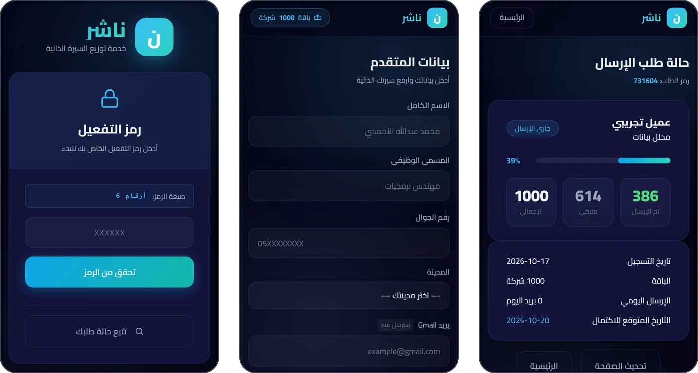
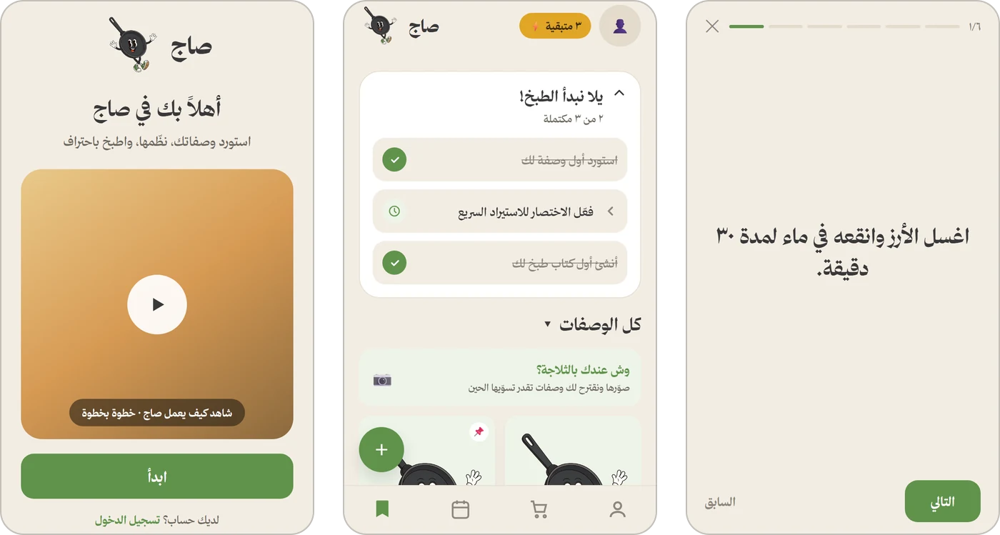

<h1 align="center">Abdullah — Growth Marketer & AI Builder</h1>

I build products with AI-assisted development and grow them with Saudi-dialect content and paid ads.

أبني منتجات بمساعدة الذكاء الاصطناعي، وأنمّيها بمحتوى باللهجة السعودية وإعلانات مدفوعة.

  <a href="https://jam3ty.pages.dev">jam3ty.pages.dev</a> ·
  <a href="mailto:ipabdullah2@gmail.com">ipabdullah2@gmail.com</a>

## About

CS student at Umm Al-Qura University (2024–2028, GPA 3.47/4.00). I run paid ads on TikTok, Meta and Snapchat, operate Salla stores, and build software with Claude Code.

My development is AI-assisted, and I say so openly. What I own is everything around the code: the product, the architecture decisions, the integrations, the deployment, and the growth.

## Featured work

### Jam3ty (جامعتي) — academic toolkit for KAU students

**240 sign-ups and 73 weekly active users from 2 days of organic TikTok/Snapchat content, with zero ad spend.**

An Arabic-first, RTL, mobile-first PWA for King Abdulaziz University students. It has a live GPA calculator, verified study plans for 87 programmes ingested from KAU's own course registry, an absence (حرمان) tracker against the 25% limit, and a clash-free schedule generator. Student data is local-first (IndexedDB) and syncs to Supabase. Launched August 2026.

- **Business model:** freemium. Premium tools unlock with activation codes bought through Salla checkout and redeemed in the app through a Cloudflare Worker.
- **Stack:** React · TypeScript · Vite · Tailwind CSS · Dexie (IndexedDB) · Supabase (Auth, Postgres, Row-Level Security) · Cloudflare Pages, Workers & D1 · Vitest · Playwright
- **Live:** [jam3ty.pages.dev](https://jam3ty.pages.dev)

### Nasher (ناشر) — automated CV distribution SaaS · *paused*

**25 paying clients in 2 weeks from TikTok ads · 17,000+ automated emails sent · 2,107 verified HR contacts across 900+ companies and 52 sectors.**

Job seekers bought a package of 500–2,000 companies. Nasher then sent their CV to Saudi HR inboxes from *their own* Gmail account, spaced out in the background. It ran from May to June 2026.

- **Pipeline:** Salla order webhook → n8n issues an activation code → delivered on WhatsApp → client self-onboards on the web app → background sender with a live progress page.
- **v1 → v2:** v1 was a command-line sender I ran by hand. v2 rebuilt it as a self-service web app with activation codes, client onboarding, a status dashboard and an admin panel, connected end-to-end to the Salla/n8n flow.
- **Data:** contact database built with Apollo.io, verified with ZeroBounce, and extended with a Python scraper.
- **Why it's paused:** I tracked clients' reply and interview rates after each send. The outcomes weren't strong enough to justify the price, so I shut Nasher down voluntarily, even though it was selling. A product that sells but doesn't deliver isn't worth scaling.
- **Stack:** Python · Flask · SQLAlchemy · Gmail SMTP · n8n · WhatsApp Cloud API · Railway
- Private repository; code available on request.

### Saaj (صاج) — AI recipe app · *in development*

Paste a TikTok, Instagram or YouTube link, or a photo or typed text, and Saaj turns it into a structured recipe with ingredients, quantities and a step-by-step cook mode. It uses the Gemini API through Supabase Edge Functions. The same pipeline powers diet-fit ingredient swaps and fridge-photo recipe suggestions.

- **Data & security:** ingredients and steps are stored as JSONB in Postgres, every user table is protected by Supabase Row-Level Security, and the Gemini key stays server-side.
- **Stack:** React Native · Expo Router · TypeScript · Zustand · Supabase (Postgres, Auth, Edge Functions) · Gemini API
- Private repository; code available on request.

<b>Other work</b>

 

- **Ad metrics dashboard:** a multi-account ad performance dashboard (Next.js, Prisma, Windsor.ai API).
- **Coursework:** university projects in Java and C++.

## Beyond code

I founded and run a self-funded e-commerce brand selling digital products. It has reached **SAR 34.8K in net sales and 594 orders, at 2.1× ROAS on TikTok ads**. The best script-led campaign hit 3.1×.

## Toolbox

**Marketing:** Saudi-dialect copywriting · TikTok, Meta & Snapchat ads · ROAS/CPA optimisation · Salla

**AI & automation:** Claude · Claude Code · n8n · Gemini API

**Tech:** Python · Flask · TypeScript · React · React Native · Supabase/PostgreSQL · C++ · Java · REST APIs · webhooks · Git

## Contact

[ipabdullah2@gmail.com](mailto:ipabdullah2@gmail.com)
